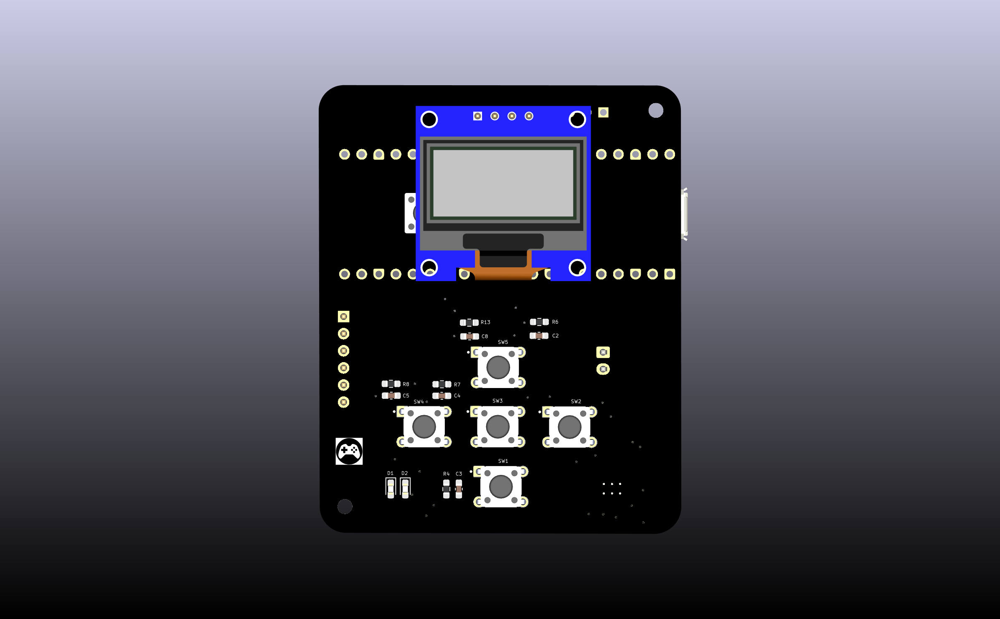
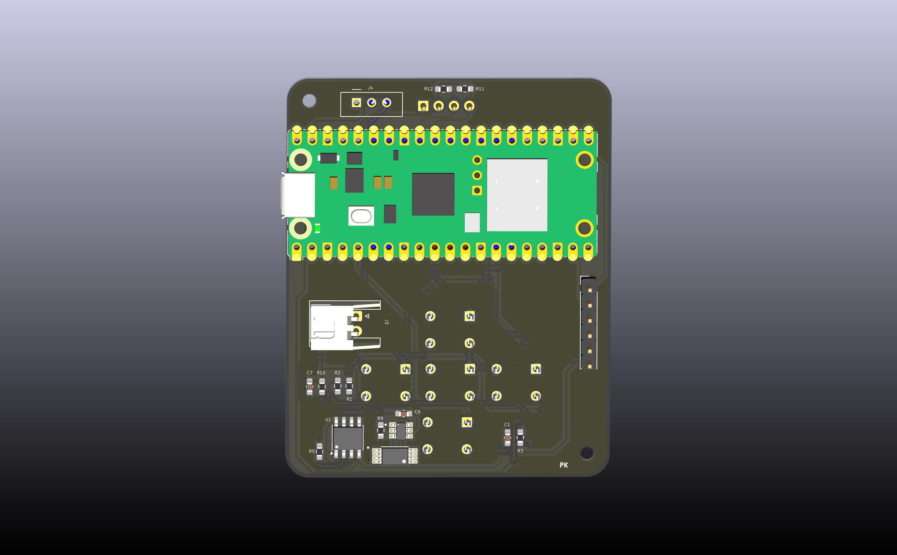

# Pocket Arcade 🕹️

A fist-sized handheld game console built from scratch — custom PCB, 10+ games, OLED display, rechargeable battery, and tactile controls. Designed and fabricated entirely from scratch using KiCad.


---

## Overview

This is a fully custom-designed handheld game console — small enough to fit in your fist. Every part of it, from the PCB layout to the game logic, was built from the ground up. 
It runs 10+ games stored on an SD card, displays them on a 1.3" OLED screen, and is powered by a rechargeable lithium battery that charges over USB via a TP4056 module.

---



## Games

| Game | Description |
|---|---|
| 🐍 Snake | Classic grow-the-snake maze game |
| 🧱 Tetris | Falling block puzzle |
| 🏓 Pong | Two-paddle ball game |
| 🚗 Car Race | Dodge oncoming traffic |
| 🦕 Dinosaur | Endless runner, jump over obstacles |

---

## Hardware

| Component | Details |
|---|---|
| Microcontroller | RP2040 (Dual-core Arm Cortex-M0+, 133 MHz) |
| Display | 1.3" OLED (SSD1306/SH1106) |
| Controls | Tactile switches — Up, Down, Left, Right, A, B |
| Storage | SD card (game assets and save data) |
| Battery | Lithium-ion rechargeable |
| Charging | TP4056 USB charging module |
| Form factor | Fist-sized, fully handheld |
| EDA Tool | KiCad |

---

## PCB Design Highlights

- **Compact layout** — everything packed into a fist-sized footprint without sacrificing signal integrity
- **RP2040 as the brain** — dual-core gives one core to game logic and the other to display rendering, keeping gameplay smooth
- **1.3" OLED over SPI/I2C** — crisp display with low power draw, perfect for battery-powered handheld use
- **SD card storage** — games and assets stored externally, easy to update without reflashing firmware
- **TP4056 charging circuit** — safe single-cell Li-ion charging with overcharge and over-discharge protection built in
- **Tactile switches** — low-profile, responsive buttons for directional and action input

---

## Getting Started

### View the Design
1. Install [KiCad](https://www.kicad.org/) (v7+ recommended)
2. Clone this repo:
   ```bash
   git clone https://github.com/Poornimakulkarni26/pocket-arcade.git
   ```
3. Open the `.kicad_pro` file in KiCad

### Flash a Game
1. Copy game `.uf2` or binary files onto the SD card
2. Insert SD card into the console
3. Power on — select game from the menu

---

## What I Learned

- Designing a compact mixed-signal PCB with power, digital, and display circuits on one board
- Managing battery power and USB charging safely with the TP4056 module
- Using RP2040's dual-core architecture to separate game logic from display rendering
- Routing SPI/I2C traces cleanly in a space-constrained layout
- Building and playing actual games on hardware I designed myself 🎮

---

## Author

**Poornima Kulkarni**
Embedded Systems & Industrial Automation Engineer

- GitHub: [@Poornimakulkarni26](https://github.com/Poornimakulkarni26)

---

## License

This project is open-source under the [MIT License](LICENSE).
